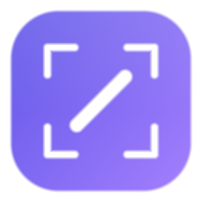
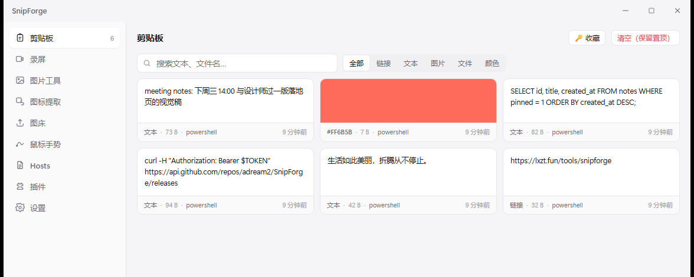
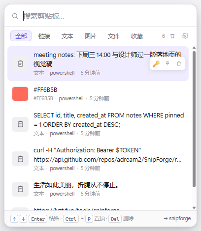
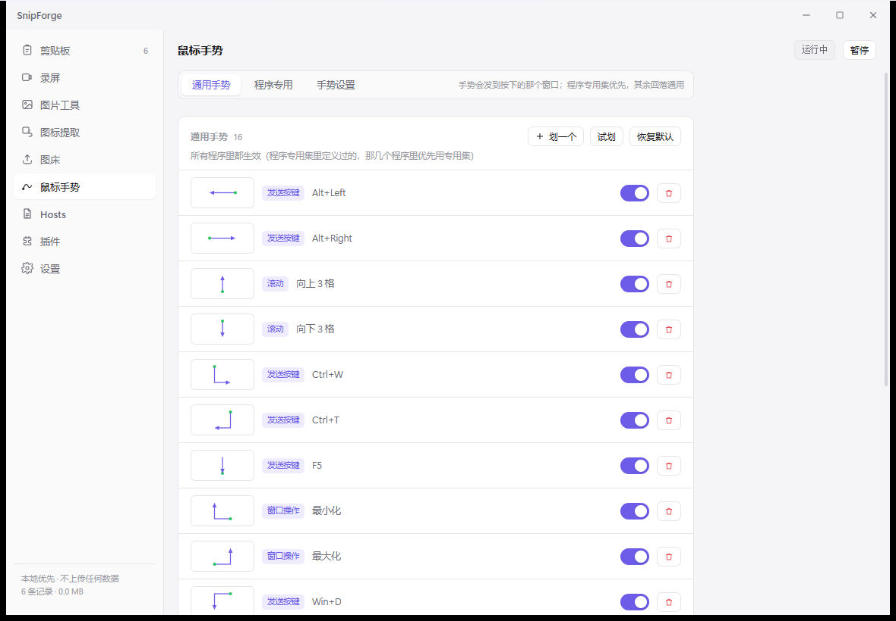
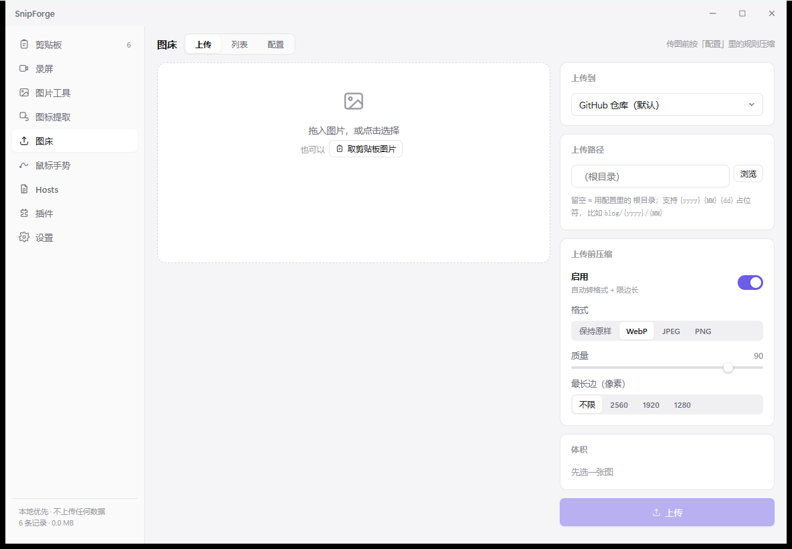

<div align="center">



# SnipForge

**截图之后的所有事，一个托盘图标解决。**

标注 · 取字 · 贴图 · 上传 · 剪贴板 · 录屏 · 图标提取

<sub>Windows 10/11 x64 · Tauri 2 + Rust + React · 安装包 2.9 MB · 常驻内存 27 MB</sub>

[产品主页](https://adream2.github.io/SnipForge/) ·
[下载最新版](https://github.com/adream2/SnipForge/releases) ·
[功能手册](docs/FEATURES.md) ·
[架构说明](docs/ARCHITECTURE.md) ·
[更新日志](CHANGELOG.md)

</div>



---

## 为什么造它

现成的工具都不缺功能，缺的是"连起来"：

| 工具 | 强项 | 断在哪 |
|---|---|---|
| ShareX | 功能全到夸张 | 界面像 2008 年，配置项几百个 |
| PicX | 图床接得最全 | 只有图床，没有截图和剪贴板 |
| QuickShot | 截图体验一流 | 只管截图 |
| TieZ | 剪贴板做得深 | 只管剪贴板 |

真实场景是「截图 → 标注 → 取字/上传 → 发出去」，中间还要翻出三天前复制的那段话。
拆成四个软件，这条链就断了。SnipForge 把它做成一条。

## 四件主要的事

### 截图与标注

`Alt+Q` 一按，画面冻住：拖拽框选、单击选窗口、`Ctrl` 选整窗、`Ctrl+A` 整屏、`S` 滚动长截图。
进编辑器后矩形/箭头/画笔/文字/序号/高亮/马赛克都有，**画完还能改**——`V` 切选择工具，
点中标注可以拖动、`Delete` 删除。取完之后做什么也能配：进编辑器、直接复制、直接保存、钉在屏幕上。

### 剪贴板

`Alt+V` 在光标旁弹出面板，选一条直接落到**你原来那个窗口**的光标处，不是"复制了让你再按一次"。
文本/图片/文件/颜色全收，按来源程序识别、可搜索、可收藏（密码类可配合主密码加密）。
`Win+V` 可以接管（低级键盘钩子，立即生效，不用重启 explorer）。



### 录屏

视频（H.264 MP4）和 GIF 分开录，`Ctrl+Alt+R` / `Ctrl+Alt+G`。
**系统声音 + 麦克风同时录并自动混音**（WASAPI loopback，不用装虚拟声卡），
静音时段按视频时间轴补静音，所以音轨不会短一截、也不会音画不同步。
摄像头可以合成画中画（圆角+描边、四角位置、大小比例、水平镜像）。

<br clear="right">

### 图床与周边

GitHub / S3 兼容 / SM.MS / 自定义 / 本地目录，写一个 JSON 就能接新图床（声明式插件）。
另外还有：**图标提取**（exe / dll / lnk / APK / IPA，含 Android 自适应图标合成）、
**鼠标手势**（八个方向组合，如 `↙↘↙` 截图）、**Hosts 编辑**（写入自动提权）、图片格式转换与压缩。

 

## 下载

| | |
|---|---|
| 产品主页 | <https://adream2.github.io/SnipForge/>（功能、截图、常见问题都在这里） |
| 发布页 | <https://github.com/adream2/SnipForge/releases> |
| 安装版 | `SnipForge_<版本>_x64-setup.exe`（当前用户安装，不需要管理员） |
| 绿色版 | `SnipForge_<版本>_x64_portable.zip`（解压双击，数据同样在 `%APPDATA%`） |
| 更新 | 启动后静默查一次，有新版本只在窗口里提示一句，**不自动下载安装**；设置 → 关于 可手动查、可关闭 |

当前是 **0.x 预览版**：接口和配置项还会变。版本号只递增，不用 `-preview.1` 这种后缀堆叠
（预览性质由 GitHub Release 的 Pre-release 标记表达）。

> 没有代码签名，首次运行 SmartScreen 会拦一下（"更多信息 → 仍要运行"）。
> 觉得不放心就下绿色包，或者自己编译。

## 常用快捷键

| 功能 | 默认键 | 功能 | 默认键 |
|---|---|---|---|
| 截图（区域内再选全屏/窗口/滚动） | `Alt+Q` | 剪贴板面板 | `Alt+V` |
| 录视频 / 录 GIF | `Ctrl+Alt+R` / `Ctrl+Alt+G` | 剪贴板贴图 | `Alt+P` |

全部可改，见 [功能手册 · 快捷键](docs/FEATURES.md)。

## 插件

两种，都不需要改主程序：

- **声明式图床**（推荐，零代码）：`plugins/*.uploader.json` 描述 URL / 字段 / 响应路径，
  放进目录就能用。参考 [`plugins/catbox.uploader.json`](plugins/catbox.uploader.json)。
- **原生扩展**：重新编译的 Rust 扩展，可以通过 `hooks`（`capture:before/after`、
  `clipboard:captured`、`image:beforeUpload`…）介入主流程。

## 架构一句话

```
入口层 (lib.rs / bootstrap / tray / shortcuts)
   ↓ 只调用
IPC 层 (commands/* 薄壳：校验参数 → 调服务 → 返回)
   ↓
能力层 (capture / clipboard / record / ocr / icons / uploader / net / vault)
   ↓ 唯一允许往下摸的地方
平台层 (win32/*：钩子、抓屏、窗口、DPI)
```

纯逻辑（配置结构、路径消毒、版本比较、订阅解析）在独立的 `snipforge-core` crate 里 ——
不依赖 GUI，所以 `cargo test` 真的能跑。细节和踩过的坑见 [ARCHITECTURE.md](docs/ARCHITECTURE.md)。

## 文档

| 文档 | 给谁看 | 内容 |
|---|---|---|
| [docs/FEATURES.md](docs/FEATURES.md) | 用户 | 完整功能清单、边界、已知限制 |
| [docs/ARCHITECTURE.md](docs/ARCHITECTURE.md) | 开发者 | 分层、启动顺序、扩展点、踩坑约束、发布流程 |
| [docs/DEVELOPMENT.md](docs/DEVELOPMENT.md) | 开发者 | 构建、自检命令、测试脚本、环境坑 |
| [CHANGELOG.md](CHANGELOG.md) | 所有人 | 每个版本改了什么 |
| [site/index.html](site/index.html) | 所有人 | 产品介绍页（单文件，本地双击即可看，也可直接部署到静态托管） |

## 许可

MIT，见 [LICENSE](LICENSE)。

设计上参考了 [ShareX](https://github.com/ShareX/ShareX) 的功能范围、
[PicX](https://github.com/XPoet/picx) 的多图床思路、
[QuickShot](https://github.com/cclank/quickshot) 的截图交互细节、
[TieZ](https://github.com/jimuzhe/tiez-clipboard) 的剪贴板工程实践。
